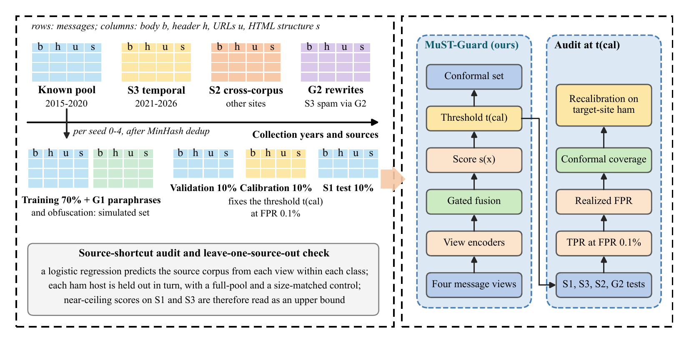
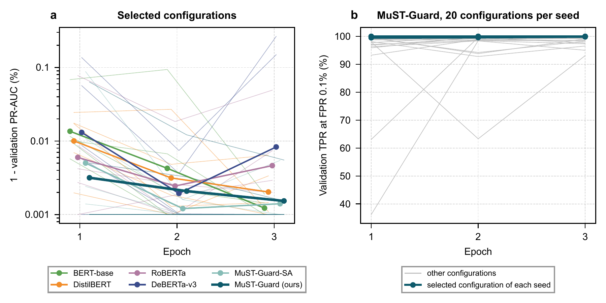
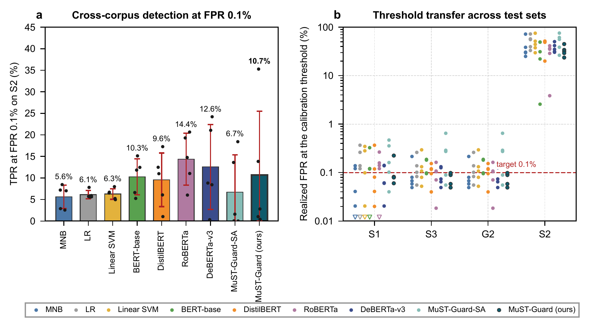
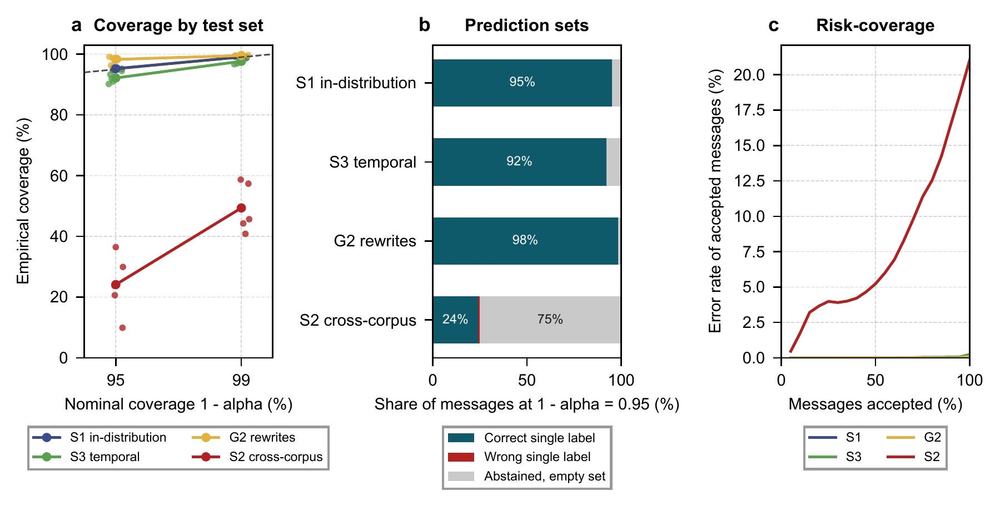

<div align="center">

# Email Threshold-Transfer Audit

### Threshold transfer in email threat detection: A multi-signal detector audited under LLM-rewritten spam, temporal drift, and corpus shift

**Anonymous authors** · this repository accompanies a manuscript under double-anonymized review

Research article · submitted to *Journal of Information Security and Applications* (Elsevier)

   

</div>

---

## Contents
[Abstract](#abstract) · [Contributions](#contributions) · [Evidence for every reported number](#evidence-for-every-reported-number) · [Method and procedure](#method-and-procedure) · [Results](#results) · [What the results show and what they do not](#what-the-results-show-and-what-they-do-not) · [Reproducibility notes](#reproducibility-notes) · [Reproducing the study](#reproducing-the-study) · [Repository layout](#repository-layout) · [Data and license](#data-and-license) · [Citation](#citation)

## Abstract
Spam and phishing filters are tuned on random splits of public corpora, yet mail in service comes from other organizations and later years, and part of it is reworded by large language models (LLMs). We propose a multi-signal shift-tolerant guard (MuST-Guard) that reads the body, sender fields, links, and HyperText Markup Language (HTML) structure of a message, weighs these views through learned gates, and abstains through split conformal prediction. An audit procedure separates in-distribution, temporal, cross-corpus, and LLM-rewrite shifts, with the test rewriter kept apart from training. MuST-Guard matched the strongest transformer baselines in-distribution, over time, and on body-only rewrites of known spam that kept links and structure, and gave the highest cross-corpus F1-score at the default threshold, although its low-false-positive discrimination stayed below that of the larger transformers. Across corpora every threshold set for a false positive rate of 0.1% blocked more than a quarter of the legitimate mail. Recalibration on local legitimate mail restored the false positive rate an order statistic predicts, yet detected fewer than one in four malicious messages. Retraining on that mail helped the single-view baselines at a cost in temporal detection; MuST-Guard kept temporal detection and led on the corpus with HTML and links, but its gates read plain-text local mail as legitimate, even when frozen. An ablation traced its in-distribution parity to augmentation and showed that its extra views lowered low-false-positive detection across corpora; a filter moved to a new site needs local recalibration and a check of its low-false-positive detection.

## Contributions
1. **An audit procedure for the operating threshold of email filters.** The audit procedure separates in-distribution, temporal, cross-corpus, and LLM-rewrite shifts, keeps the rewriting model of the test apart from the augmentation model of training, and bounds every score with a source-shortcut audit and a leave-one-source-out check. It reads only the scores of a filter and was applied to nine models under one tuning budget.
2. **MuST-Guard, a four-view detector with gated fusion and conformal abstention.** It reads the body, the sender fields, the links, and the HTML structure of a message and weighs the views that are present. It matched the strongest transformers in-distribution, over time, and on rewrites by an unseen LLM, and it gave the highest cross-corpus F1-score at the default threshold. An ablation showed that the in-distribution parity came from augmentation and that the extra views lowered low-false-positive detection across corpora; its shift-aware variant, MuST-Guard-SA, is reported as a design that did not help.
3. **Evidence that the operating threshold does not transfer across corpora.** A threshold set for an FPR of 0.1% blocked 29% to 52% of the legitimate mail of a new corpus for every model, and ranking in the low false positive range failed with it while ranking over the whole range stayed high. Body-only rewrites of known campaigns by an unseen LLM did not lower detection; these rewrites kept the subject, sender, links, and HTML structure, which carry about half of the spam weight of MuST-Guard, so the test does not show robustness to LLM-written campaigns.
4. **Recalibration and adaptation on target-site ham.** Local ham brought the false positive rate to the level an order statistic predicts but left most spam undetected. Retraining on local ham without spam labels raised pooled detection for the single-view models at a cost in temporal detection, whereas MuST-Guard kept its temporal detection and caught 83.2% of the SpamAssassin spam, the most of any adapted model; freezing its gates during adaptation did not change its detection. Split manifests, rewrite identifiers, and scripts are available for repeating the audit.

<p align="center"></p>
<p align="center"><em><b>Figure 1.</b> Audit procedure. Left: message sets from the known pool dated 2015 to 2020 to the unseen S3, S2 and G2 test sets, and the per-seed split in which G<sub>1</sub> paraphrases enter training only. Right: MuST-Guard produces scores and conformal sets, and every test set is audited at the fixed threshold before recalibration on target-site ham.</em> <a href="figures/figure1.pdf">[PDF]</a></p>

## Evidence for every reported number
No table of the paper was typed by hand. Each one is written by a script from the stored score files and can be checked with one command:

| What | Evidence in this repository | How to check |
|---|---|---|
| Tables of detection, operating points, standard metrics, statistics, recalibration, conformal abstention | per-run score files in `results/gpu7/`, `results/mustguard/`, `results/a10/`, `results/a11/`; summaries `results/extra_analysis.json`, `results/results_jisa.json`, `results/results_revision.json` | `python verify_results.py` |
| Target-site adaptation, gate weights | `results/a13/`, `results/results_a13.json` | `python verify_results.py` |
| Ablation and frozen-gate adaptation | `results/a14/`, `results/results_a14.json` | `python verify_results.py` |
| Training curves | `log_*.json` of every configuration and seed | read directly |
| Integrity of the result files | `CHECKSUMS.sha256` | `shasum -a 256 -c CHECKSUMS.sha256` |

`verify_results.py` reruns every analysis script on the stored scores and compares each regenerated table body with the published copy byte for byte. 35 of 35 regenerated tables are identical; the report is in [`results/verification_report.md`](results/verification_report.md). Two table bodies are not regenerated: the dated amendments to the study plan and the data-flow counts, both written by hand.

## Method and procedure
- **Detector.** MuST-Guard encodes the body with DeBERTa-v3-small, the sender fields and the links with byte-level CNNs, and the HTML structure with an MLP, weighs the views by gates normalized over the views that are present, and abstains through split conformal prediction.
- **Baselines.** Multinomial naive Bayes, logistic regression and a linear SVM on TF-IDF features; BERT-base, DistilBERT, RoBERTa-base and DeBERTa-v3-base on subject and body.
- **Budget.** 20 configurations per seed for every model, selected by validation PR-AUC; seeds 0 to 4.
- **Threshold.** Fixed at an FPR of 0.1% on the calibration split and transferred unchanged to every test set.

| Setting | Value |
|---|---|
| Known pool | Apache, GNU, Python and Fedora mailing-list ham, Untroubled spam, Nazario phishing, 2015–2020; split 70:10:10:10 per seed by near-duplicate cluster |
| S3, temporal | the same sources, 2021–2026 |
| S2, cross-corpus | SpamAssassin public corpus and Enron-Spam |
| G2, rewrites | S3 spam reworded by Mistral-7B-Instruct, body only, links kept; training paraphrases come from Qwen2.5-7B-Instruct |
| Statistics | two-stage bootstrap over seeds and messages, threshold re-estimated in every replicate, Holm adjustment |

<p align="center"></p>
<p align="center"><em><b>Figure 2.</b> MuST-Guard. Four views are encoded into embeddings h<sup>v</sup>, weighted by gates a<sup>v</sup>, decoded into a score s(x), compared with the calibration threshold, and checked by a split conformal set; an empty set means abstention.</em> <a href="figures/figure2.pdf">[PDF]</a></p>

<p align="center"></p>
<p align="center"><em><b>Figure 3.</b> Convergence on the validation split: one minus the validation PR-AUC of each selected configuration by epoch, and the validation TPR at an FPR of 0.1% of all 20 MuST-Guard configurations of each seed.</em> <a href="figures/figure3.pdf">[PDF]</a></p>

## Results
### Detection and threshold transfer
TPR at an FPR of 0.1%, and the FPR realized on S2 by the transferred threshold, percent, mean ± SD over five seeds:

| Model | Seeds | S1 | S3 | G2 | S2 | S2 realized FPR |
|---|---:|---:|---:|---:|---:|---:|
| Multinomial naive Bayes | 5 | 98.7 ± 1.0 | 95.9 ± 1.5 | 94.4 ± 4.6 | 5.6 ± 2.7 | 39.2 ± 19.0 |
| Logistic regression | 5 | 99.0 ± 1.3 | 98.4 ± 0.7 | 97.2 ± 0.2 | 6.1 ± 1.0 | 51.6 ± 15.6 |
| Linear SVM | 5 | 99.2 ± 1.2 | 97.8 ± 1.6 | 96.6 ± 1.4 | 6.3 ± 1.2 | 47.6 ± 17.4 |
| BERT-base | 5 | 98.2 ± 3.7 | 99.5 ± 0.1 | 99.3 ± 0.3 | 10.3 ± 4.2 | 30.9 ± 19.7 |
| DistilBERT | 5 | 98.1 ± 4.0 | 99.5 ± 0.1 | 99.5 ± 0.3 | 9.6 ± 6.2 | 44.4 ± 13.7 |
| RoBERTa-base | 5 | 99.3 ± 1.3 | 99.3 ± 0.4 | 99.5 ± 0.2 | 14.4 ± 6.0 | 29.1 ± 14.8 |
| DeBERTa-v3-base | 5 | 99.8 ± 0.1 | 99.6 ± 0.1 | 99.8 ± 0.1 | 12.6 ± 9.9 | 37.8 ± 8.3 |
| MuST-Guard-SA (ours) | 5 | 99.4 ± 1.0 | 99.5 ± 0.2 | 99.7 ± 0.3 | 6.7 ± 8.7 | 51.6 ± 19.3 |
| MuST-Guard (ours) | 5 | 99.7 ± 0.4 | 99.5 ± 0.3 | 99.6 ± 0.2 | 10.7 ± 14.8 | 32.7 ± 7.9 |

<p align="center"></p>
<p align="center"><em><b>Figure 4.</b> Cross-corpus failure: TPR at an FPR of 0.1% on S2 with one dot per seed, and the FPR realized on each test set by the threshold fixed on the calibration split.</em> <a href="figures/figure4.pdf">[PDF]</a></p>

### Retraining on target-site ham
Threshold set on 5,000 target-calibration ham; S2 TPR without and with retraining on 5,000 adaptation ham, percent, mean over five seeds:

| Model | S2 recalibrated | S2 adapted | Enron-Spam | SpamAssassin | FPR | S1 | S3 |
|---|---:|---:|---:|---:|---:|---:|---:|
| Multinomial naive Bayes | 5.4 | 23.7 ± 3.5 | 22.6 | 33.2 | 0.10 | 98.9 | 91.3 |
| Logistic regression | 6.1 | 21.5 ± 1.3 | 16.7 | 62.3 | 0.13 | 98.2 | 94.6 |
| Linear SVM | 5.7 | 25.9 ± 12.8 | 22.2 | 57.5 | 0.14 | 98.7 | 93.8 |
| BERT-base | 11.9 | 15.7 ± 8.3 | 8.5 | 76.7 | 0.11 | 99.6 | 99.0 |
| DistilBERT | 13.4 | 52.6 ± 6.8 | 52.6 | 52.8 | 0.09 | 98.7 | 96.6 |
| MuST-Guard (ours) | 10.8 | 10.6 ± 1.8 | 2.0 | 83.2 | 0.16 | 99.7 | 99.3 |

### Ablation, seeds 0–2
| Variant | S1 | S3 | G2 rewrites | G2 drop | S2 | S2 realized FPR |
|---|---:|---:|---:|---:|---:|---:|
| Body view, no augmentation | 98.6 ± 2.4 | 98.9 ± 1.0 | 99.0 ± 0.8 | -0.06 | 21.4 ± 16.7 | 28.8 ± 11.6 |
| Body view | 99.7 ± 0.4 | 99.5 ± 0.0 | 99.6 ± 0.1 | -0.09 | 20.2 ± 11.7 | 34.6 ± 13.7 |
| Four views, no augmentation | 99.6 ± 0.7 | 99.5 ± 0.2 | 99.6 ± 0.1 | +0.09 | 5.7 ± 5.4 | 38.6 ± 23.6 |
| Without the structure view | 99.6 ± 0.4 | 99.5 ± 0.1 | 99.7 ± 0.1 | -0.15 | 12.7 ± 13.2 | 39.9 ± 16.0 |
| MuST-Guard (ours) | 99.7 ± 0.5 | 99.5 ± 0.1 | 99.6 ± 0.1 | +0.00 | 1.4 ± 1.3 | 36.9 ± 7.1 |

### Frozen-gate adaptation, five seeds
| Arm | S2 TPR | Enron-Spam | SpamAssassin | FPR | S1 | S3 | Body gate | Structure gate |
|---|---:|---:|---:|---:|---:|---:|---:|---:|
| Recalibrated only | 18.7 ± 12.6 | 14.9 | 50.6 | 0.14 | 99.7 | 99.4 | 0.37 | 0.50 |
| Adapted, gate trainable | 12.6 ± 3.1 | 3.7 | 88.7 | 0.15 | 99.7 | 99.3 | 0.92 | 0.07 |
| Adapted, gate frozen | 12.7 ± 1.6 | 3.5 | 90.0 | 0.15 | 99.7 | 99.3 | 0.84 | 0.15 |

<p align="center"></p>
<p align="center"><em><b>Figure 7.</b> Conformal abstention of MuST-Guard: coverage against the nominal level, composition of the prediction sets, and risk–coverage at the calibration threshold.</em> <a href="figures/figure7.pdf">[PDF]</a></p>

<p align="center"></p>
<p align="center"><em><b>Figure 8.</b> Recalibration on target-site ham: realized FPR on the remaining S2 ham, mean and 95th percentile, and TPR at the recalibrated threshold.</em> <a href="figures/figure8.pdf">[PDF]</a></p>

Every other table of the paper is in [`results/tables/`](results/tables).

## What the results show and what they do not
- **Shown.** A threshold fixed at an FPR of 0.1% on the training pool blocked 29% to 52% of the legitimate mail of another corpus for every model, while ROC-AUC stayed high.
- **Shown.** Recalibration on local ham brought the false positive rate to the level an order statistic predicts, but most spam was still missed.
- **Shown.** MuST-Guard matched the strongest transformers in-distribution, over time and on body-only rewrites, and gave the highest cross-corpus F1-score at the default threshold.
- **Not shown.** MuST-Guard is not better than the transformers at low false positive rates across corpora; no difference with them survived the bootstrap.
- **Not shown.** The extra views do not help across corpora. In the ablation, the body view alone ranked S2 spam better than the full model, and freezing the fusion gates did not prevent the Enron-Spam collapse after adaptation.
- **Scope.** The rewrites changed only the body and kept links and HTML; they do not show robustness to LLM-written campaigns. Public archives, mostly mailing-list ham.

## Reproducibility notes
- **Half-precision ties.** Transformer scores are stored in half precision, so a few spam scores can equal the threshold; the rule flags a message when its score is strictly above the threshold.
- **Amendments.** Every change to the study plan is dated in the amendment table of the paper; the ablation and the frozen-gate analysis were fixed before their runs and were run once.
- **Hardware.** Transformer models were trained on NVIDIA T4 GPUs; the analyses run on a CPU.

## Reproducing the study
Python 3.10:

```bash
pip install -r requirements.txt
```

**Checks in minutes, no retraining**, from the repository root:

```bash
python verify_results.py        # reruns every analysis on the stored scores, compares each table byte for byte
shasum -a 256 -c CHECKSUMS.sha256
```

**Full reruns** need the corpora, which are downloaded from their original sources:

```bash
python code/data/download.py && python code/data/build_dataset.py && python code/data/make_splits.py
python code/llm_rewrite/rewrite.py && python code/llm_rewrite/filter_rewrites.py
python code/baselines/classical.py
python code/gpu/run_model_seed.py <hf_model> <seed>
python code/mustguard/run_mg_seed.py microsoft/deberta-v3-small <seed>
```

| Script | Purpose |
|---|---|
| `code/data/` | download, parsing, exact and MinHash deduplication, per-seed splits |
| `code/audit/source_audit.py` | source-shortcut audit |
| `code/baselines/` | classical baselines, G2 scoring, leave-one-source-out check |
| `code/llm_rewrite/` | G1 paraphrases, G2 rewrites, link-preserving filter |
| `code/gpu/` | transformer baselines |
| `code/mustguard/` | MuST-Guard model, training, scoring, fusion-weight audit |
| `code/a11/`, `code/a13/`, `code/a14/` | shift-aware variant, target-site adaptation, ablation and frozen-gate adaptation |
| `code/report/`, `code/analysis/` | statistics, bootstrap, recalibration, conformal analyses and every table |
| `verify_results.py` | regenerates every table from the stored scores |

## Repository layout
```
code/                    data, models, baselines, analyses
data/
  splits.parquet         split of every message for seeds 0-4
  message_meta.parquet   source, label, month and duplicate cluster of every message, no text
  rewrite_g1_ids.parquet, rewrite_g2_ids.parquet   identifiers of the kept rewrites
results/
  gpu7/, mustguard/, a10/, a11/, a13/, a14/   per-run scores, selected configurations, training logs
  results_*.json, extra_analysis.json        summaries behind the tables
  tables/                                    every table body of the paper
  verification_report.md                     output of verify_results.py
figures/                 figures of the paper, vector PDF; png/ holds 300-dpi copies shown on this page
CHECKSUMS.sha256         SHA-256 of every result file
```

## Data and license
The corpora are public: the Apache, GNU, Python and Fedora mailing-list archives, the Untroubled spam archive, the Nazario phishing corpus (CC BY 4.0), the SpamAssassin public corpus and Enron-Spam. Message texts are not redistributed; `code/data/download.py` retrieves them from their original sources. The code is released under the MIT License.

## Citation
Citation details are added after the review.

## Contact
Questions during the review go through the journal's editorial system; author details are added after the review.
