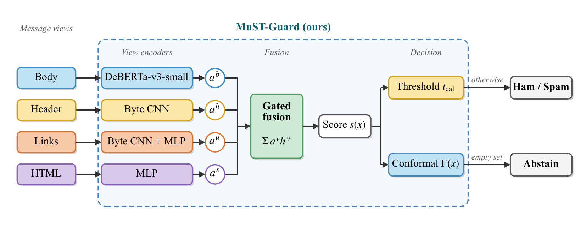
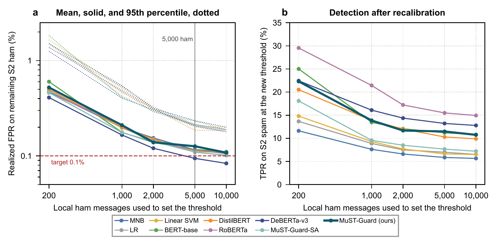

# Threshold transfer in email threat detection

Code, split manifests, and results for the manuscript **"Threshold transfer in email threat detection: A multi-signal
detector audited under LLM-rewritten spam, temporal drift, and corpus shift"**, under double-anonymized review.

Contents: [Overview](#overview) · [Audit procedure](#audit-procedure) · [Results](#results) · [Reproducing](#reproducing) ·
[Repository layout](#repository-layout) · [Data](#data)

## Overview
Spam and phishing filters run at a very low false positive rate, and the threshold that gives this rate is fixed on
held-out data from the training pool. This repository audits whether that threshold transfers to mail from other
organizations, later years, and rewording by a large language model, for nine filters: three classical models, four
transformer encoders, and MuST-Guard, a four-view detector with gated fusion and conformal abstention, with its
shift-aware variant.

<p align="center"></p>

*Figure 1. Audit procedure: known, simulated, and unseen message sets and the per-seed split.* [PDF](figures/figure1.pdf)

<p align="center"></p>

*Figure 2. MuST-Guard: four message views, gated fusion, a calibrated threshold, and split conformal abstention.* [PDF](figures/figure2.pdf)


## Audit procedure
1. Parse, deduplicate exactly and by MinHash clusters, and split the 2015-2020 pool by cluster per seed, 70:10:10:10.
2. Train every model with the same budget of 20 configurations per seed; select by validation PR-AUC.
3. Fix the threshold at an FPR of 0.1% on the calibration split and score S1 in-distribution, S3 temporal 2021-2026,
   S2 cross-corpus SpamAssassin and Enron-Spam, and G2 body-only rewrites by an unseen LLM.
4. Report the TPR at an FPR of 0.1%, the realized FPR at the fixed threshold, conformal coverage, recalibration on
   target-site ham against an order-statistic reference, and retraining on target-site ham without target spam labels.
5. Compare models with a two-stage bootstrap over seeds and messages, with Holm adjustment.

## Results
TPR at an FPR of 0.1% and the FPR realized on S2 at the transferred threshold, percent, mean ± SD over seeds:

| Model | Seeds | S1 | S3 | G2 | S2 | S2 realized FPR |
|---|---|---|---|---|---|---|
| Multinomial naive Bayes | 5 | 98.7 ± 1.0 | 95.9 ± 1.5 | 94.4 ± 4.6 | 5.6 ± 2.7 | 39.2 ± 19.0 |
| Logistic regression | 5 | 99.0 ± 1.3 | 98.4 ± 0.7 | 97.2 ± 0.2 | 6.1 ± 1.0 | 51.6 ± 15.6 |
| Linear SVM | 5 | 99.2 ± 1.2 | 97.8 ± 1.6 | 96.6 ± 1.4 | 6.3 ± 1.2 | 47.6 ± 17.4 |
| BERT-base | 5 | 98.2 ± 3.7 | 99.5 ± 0.1 | 99.3 ± 0.3 | 10.3 ± 4.2 | 30.9 ± 19.7 |
| DistilBERT | 5 | 98.1 ± 4.0 | 99.5 ± 0.1 | 99.5 ± 0.3 | 9.6 ± 6.2 | 44.4 ± 13.7 |
| RoBERTa-base | 5 | 99.3 ± 1.3 | 99.3 ± 0.4 | 99.5 ± 0.2 | 14.4 ± 6.0 | 29.1 ± 14.8 |
| DeBERTa-v3-base | 5 | 99.8 ± 0.1 | 99.6 ± 0.1 | 99.8 ± 0.1 | 12.6 ± 9.9 | 37.8 ± 8.3 |
| MuST-Guard-SA (ours) | 5 | 99.4 ± 1.0 | 99.5 ± 0.2 | 99.7 ± 0.3 | 6.7 ± 8.7 | 51.6 ± 19.3 |
| MuST-Guard (ours) | 5 | 99.7 ± 0.4 | 99.5 ± 0.3 | 99.6 ± 0.2 | 10.7 ± 14.8 | 32.7 ± 7.9 |

<p align="center"></p>

*Figure 4. Cross-corpus failure: detection at an FPR of 0.1% on S2 and the FPR realized by the transferred threshold.* [PDF](figures/figure4.pdf)


Retraining on 5,000 target-site ham, percent, mean over five seeds:

| Model | S2 TPR recalibrated | S2 TPR adapted | Enron-Spam | SpamAssassin | FPR | S1 | S3 |
|---|---|---|---|---|---|---|---|
| Multinomial naive Bayes | 5.4 | 23.7 ± 3.5 | 22.6 | 33.2 | 0.10 | 98.9 | 91.3 |
| Logistic regression | 6.1 | 21.5 ± 1.3 | 16.7 | 62.3 | 0.13 | 98.2 | 94.6 |
| Linear SVM | 5.7 | 25.9 ± 12.8 | 22.2 | 57.5 | 0.14 | 98.7 | 93.8 |
| BERT-base | 11.9 | 15.7 ± 8.3 | 8.5 | 76.7 | 0.11 | 99.6 | 99.0 |
| DistilBERT | 13.4 | 52.6 ± 6.8 | 52.6 | 52.8 | 0.09 | 98.7 | 96.6 |
| MuST-Guard (ours) | 10.8 | 10.6 ± 1.8 | 2.0 | 83.2 | 0.16 | 99.7 | 99.3 |

<p align="center"></p>

*Figure 8. Recalibration on target-site ham: realized FPR against the number of local ham messages, and detection.* [PDF](figures/figure8.pdf)


Ablation of MuST-Guard on seeds 0-2, TPR at an FPR of 0.1% and the FPR realized on S2, percent:

| Variant | S1 | S3 | G2 rewrites | G2 drop | S2 | S2 realized FPR |
|---|---|---|---|---|---|---|
| Body view, no augmentation | 98.6 ± 2.4 | 98.9 ± 1.0 | 99.0 ± 0.8 | -0.06 | 21.4 ± 16.7 | 28.8 ± 11.6 |
| Body view | 99.7 ± 0.4 | 99.5 ± 0.0 | 99.6 ± 0.1 | -0.09 | 20.2 ± 11.7 | 34.6 ± 13.7 |
| Four views, no augmentation | 99.6 ± 0.7 | 99.5 ± 0.2 | 99.6 ± 0.1 | +0.09 | 5.7 ± 5.4 | 38.6 ± 23.6 |
| Without the structure view | 99.6 ± 0.4 | 99.5 ± 0.1 | 99.7 ± 0.1 | -0.15 | 12.7 ± 13.2 | 39.9 ± 16.0 |
| MuST-Guard (ours) | 99.7 ± 0.5 | 99.5 ± 0.1 | 99.6 ± 0.1 | +0.00 | 1.4 ± 1.3 | 36.9 ± 7.1 |

Frozen-gate adaptation, five seeds, percent and gate weights on the Enron-Spam spam:

| Arm | S2 TPR | Enron-Spam | SpamAssassin | FPR | S1 | S3 | Body | Structure |
|---|---|---|---|---|---|---|---|---|
| Recalibrated only | 18.7 ± 12.6 | 14.9 | 50.6 | 0.14 | 99.7 | 99.4 | 0.37 | 0.50 |
| Adapted, gate trainable | 12.6 ± 3.1 | 3.7 | 88.7 | 0.15 | 99.7 | 99.3 | 0.92 | 0.07 |
| Adapted, gate frozen | 12.7 ± 1.6 | 3.5 | 90.0 | 0.15 | 99.7 | 99.3 | 0.84 | 0.15 |

All tables of the manuscript are in [`results/tables/`](results/tables) and the numbers behind them in
[`results/`](results).

## Reproducing
```bash
pip install -r requirements.txt
python code/data/download.py            # public corpora, checked against the download manifest
python code/data/build_dataset.py       # parsing, exact and near-duplicate removal
python code/data/make_splits.py         # per-seed splits; compare with data/splits.parquet
python code/llm_rewrite/rewrite.py      # G1 and G2 rewrites, then code/llm_rewrite/filter_rewrites.py
python code/baselines/classical.py      # classical baselines
python code/gpu/run_model_seed.py <hf_model> <seed>        # transformer baselines, one seed per job
python code/mustguard/run_mg_seed.py microsoft/deberta-v3-small <seed>
python code/report/extra_analysis.py && python code/analysis/jisa_tables.py && python code/analysis/jisa_revision.py
```
GPU jobs ran on NVIDIA T4 GPUs. The analysis scripts read the per-run score files written by the training jobs.

## Repository layout
```
code/data          download, parsing, deduplication, splits
code/audit         source-shortcut audit
code/baselines     classical baselines and the leave-one-source-out check
code/llm_rewrite   paraphrase and stress-set rewriting and the link-preserving filter
code/gpu           transformer baselines
code/mustguard     MuST-Guard model, training, and scoring
code/a11 a13 a14   shift-aware variant, target-site adaptation, ablation and frozen-gate adaptation
code/report        statistics and tables; code/analysis: bootstrap, recalibration, conformal analyses
data               split manifest and rewrite identifiers
results            result summaries and all manuscript tables
figures            vector figures and 300-dpi PNG copies
```

## Data
The corpora are public: the Apache, GNU, Python, and Fedora mailing-list archives, the Untroubled spam archive, the
Nazario phishing corpus, the SpamAssassin public corpus, and Enron-Spam. Message texts are not redistributed here;
`code/data/download.py` retrieves them from their original sources, and `data/splits.parquet` fixes the split of
every message for seeds 0-4.

## License
Code: MIT. The corpora keep the licenses of their original sources.
